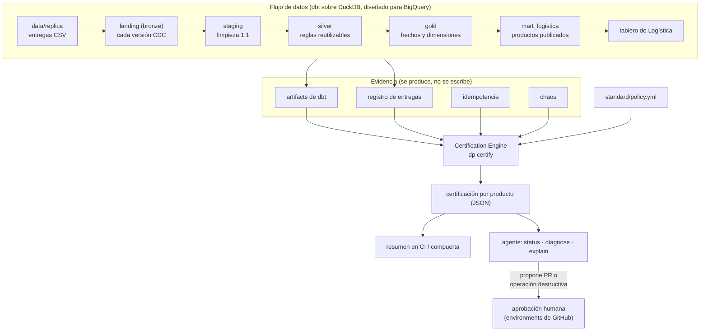

# Estándar ejecutable de ingeniería de datos

Un workspace agéntico que lleva una tabla replicada hasta un **producto de datos certificado**
siguiendo siempre el mismo estándar:

```
ingesta → staging → transformación → testing → observabilidad → gobernanza → performance → certificación
```

La tesis: el conocimiento para construir marts confiables no debe vivir en la cabeza de cada
ingeniero. Aquí vive en **reglas como código, herramientas deterministas y validaciones que no
dependen de que nadie se acuerde**, y un agente las aplica siempre. Los dos marts de Logística
son la evidencia de que el estándar funciona; el producto es el estándar.

> El LLM interpreta evidencia y propone. El sistema (tests, contratos, política, certificación,
> CI, aprobación humana) decide si algo cumple.

---

## Inicio rápido

Requisitos: Python 3.9 o superior, Git y `make`. Sin credenciales ni servicios externos.

```bash
make setup     # .venv con dependencias fijadas
make all       # ingesta + dbt build + certificación
make verify    # corre todo dos veces y compara filas y contenido de cada tabla
make chaos     # rompe algo a propósito: detección, explicación, corrección y recertificación
make chaos-suite  # verifica en sandbox que el estándar detecta las 10 fallas conocidas
make test      # pruebas de las herramientas
```

Resultado esperado de `make all`:

```
cumplimiento_entrega     CERTIFIED                salud HEALTHY   razones: -
embarques_mensual        CERTIFIED                salud HEALTHY   razones: -
```

Las tablas quedan en el esquema `mart_logistica` de `deacero.duckdb`, como pide el contrato.

### El agente

| | |
|---|---|
| Agente | [opencode](https://opencode.ai) (`npm i -g opencode-ai`) |
| Modelo | `google/gemini-2.5-flash`, plan gratuito de Google AI Studio (sin tarjeta) |
| Llave | Variable de entorno `GOOGLE_GENERATIVE_AI_API_KEY`. Nunca en el repo |
| Configuración | [`opencode.json`](opencode.json) (modelo y permisos), [`AGENTS.md`](AGENTS.md) (contexto), [`.agents/skills/`](.agents/skills) (recetas) |

```bash
export GOOGLE_GENERATIVE_AI_API_KEY=...   # tu llave
opencode                                    # desde la raíz del repo
```

Otro modelo gratuito: `opencode --model <proveedor/modelo>` (por ejemplo Groq u Ollama local).

**Diseñado para los límites de un plan gratuito:** el trabajo pesado lo hacen herramientas
deterministas que devuelven resúmenes cortos; `AGENTS.md` es breve y las skills se cargan solo
cuando se necesitan; la evidencia se pide por capas (`status` → `diagnose` → `explain`) en lugar
de leer artifacts completos.

---

## Cómo responde a cada prueba de la evaluación

| Prueba | Qué pasa | Dónde verlo |
|---|---|---|
| 1. Correr todo dos veces y contar filas | La ingesta registra cada archivo por hash y no lo vuelve a cargar; staging deduplica el CDC por llave y LSN; los modelos se reconstruyen. `make verify` compara filas y hash de contenido de cada tabla entre dos corridas | `dp verify-idempotency`, [`src/dp/ingest.py`](src/dp/ingest.py) |
| 2. Entregas nuevas de la réplica | Copia la carpeta en `data/replica/carga_N/` y corre `make all`. Reenvíos, archivos modificados, tablas no declaradas, columnas faltantes o nuevas, borrados y correcciones con el mismo timestamp tienen un tratamiento definido | skill `ingerir-entrega`, `dp ingest` |
| 3. Su propio chaos | El agente empieza por `dp certify status` y `dp diagnose`: nodo que falló, regla, filas de muestra, diff del unit test (esperado vs real) y mecanismos conocidos del catálogo. Responde con **mecanismo**, no con el stack trace, y propone el fix como PR | skill `diagnosticar-falla`, [`standard/chaos/catalogo.yml`](standard/chaos/catalogo.yml) |
| 4. Fuente y requerimiento nuevos | `dp new-source` genera la fuente y el staging estándar desde el CSV; la skill `nueva-fuente-a-mart` guía capas, reglas como tests y certificación. La ficha de certificación es la checklist. Probado con una fuente de otro dominio | [`tests/test_scaffold.py`](tests/test_scaffold.py), [`tests/test_certify.py`](tests/test_certify.py) |
| 5. Algo destructivo sin aprobación | El agente no tiene cómo: `dp build --full-refresh` se niega fuera del job aprobado, los permisos del agente lo bloquean y la operación solo existe en un workflow que espera a un revisor. El agente usa `dp propose` y pide la aprobación | [Frontera humana](#frontera-humana) |

---

## Arquitectura



| Capa | Qué hace | Modelos |
|---|---|---|
| landing | Réplica tal cual llega, en texto, con columnas de linaje `_dp_*`. Inmutable | `landing_fle.*`, `landing_vta.*`, `landing_opc.*` |
| staging | 1:1 con la fuente: última versión CDC por llave (LSN), borrados aplicados, casts seguros, centinelas a nulo, códigos normalizados. Sin reglas de negocio | `stg_<sistema>__<entidad>` |
| silver | Reglas reutilizables: vigencia del segmento (SCD2 desde el CDC) y viajes embarcados con fecha y puntualidad | `int_*` |
| gold | Cada medida en su grano: costo en `fct_viajes`, toneladas en `fct_embarques` | `fct_*`, `dim_*` |
| mart | Productos publicados con contrato aplicado y metadata de gobierno | `embarques_mensual`, `cumplimiento_entrega` |

### Las cuatro capacidades transversales

| Capacidad | Pregunta | Cómo se implementa |
|---|---|---|
| Testing | ¿Está construido correctamente? | Tests técnicos, de ingeniería (CDC, borrados, fan-out, cobertura, centinelas, casts), de negocio (uno por regla, recalculado desde staging), unit tests con fixtures de cada trampa, idempotencia y chaos |
| Observabilidad | ¿Funciona correctamente ahora? | Frescura de cada fuente, el producto refleja la última entrega, volumen y esquema por entrega, estado del pipeline. Salud: `HEALTHY`, `AT_RISK`, `STALE`, `FAILED`, `UNKNOWN` |
| Gobernanza | ¿Está controlado, entendido y tiene responsables? | Dueño (`group`), contrato aplicado y versionado, grano y llaves con test, documentación, reglas ↔ tests, linaje hasta el consumidor, control de cambios (GOV-07) |
| Performance / FinOps | ¿Usa los recursos de manera razonable? | Diseño para BigQuery (partición y clustering o exención justificada, sin `SELECT *`), duración medida. Bytes, slots y costo de BigQuery se reportan como `not_available` en local: no se simulan |

---

## Certificación

`dp certify run` evalúa la evidencia de la última corrida contra [`standard/policy.yml`](standard/policy.yml)
y escribe un JSON por producto en `.certification/`. Misma evidencia, misma política y misma
versión del engine dan el mismo resultado.

| Estado | Significa | Se recupera |
|---|---|---|
| `CERTIFIED` | La versión cumple el estándar y los datos de hoy son confiables | — |
| `CERTIFIED_WITH_WARNINGS` | Cumple lo crítico; hay advertencias | Resolviendo la advertencia |
| `DEGRADED` | **La versión es válida, la operación no** (datos atrasados, entrega rota, regla violada por los datos recibidos) | Con una corrida sana, sin cambiar código (o escalando al origen) |
| `NOT_CERTIFIED` | **La versión no cumple el estándar** | Con un cambio: PR, o aprobación humana si es un cambio gobernado |

La evidencia que falta es `UNKNOWN` y nunca cuenta como PASS. El contexto define qué juzga un
test de datos que falla: en operación (`run`) juzga los datos; en una versión candidata
(`candidate`, `ci`) juzga el código.

```bash
dp certify status                          # todos los productos
dp certify status embarques_mensual        # razones con evidencia mínima (para el agente)
dp certify explain embarques_mensual TST-05   # evidencia completa con filas que fallan
```

**Reloj replay.** Los datos del reto son históricos (extraídos el 2026-07-01). La frescura se
mide contra la última entrega, no contra la hora real; la certificación registra `clock` y
`as_of` para que un `HEALTHY` local nunca se lea como frescura productiva. En producción el reloj
es la hora real. `dp certify run --as-of <instante>` permite probar el SLA.

---

## Contexto, skill o validación

Lo crítico no depende de que el agente se acuerde.

| Va como… | Criterio | Qué quedó ahí |
|---|---|---|
| **Contexto** ([`AGENTS.md`](AGENTS.md)) | Quién eres y qué reglas sigues: se lee siempre | Las 10 reglas del estándar, el mapa de herramientas y del repo, a qué skill va cada tipo de petición |
| **Skill** ([`.agents/skills/`](.agents/skills)) | Cómo se hace algo: se carga cuando hace falta | Nueva fuente a mart certificado, ingerir una entrega, perfilar una tabla, diagnosticar una falla, proponer un cambio destructivo |
| **Herramienta** ([`src/dp/`](src/dp)) | Algo que se ejecuta y produce evidencia | `ingest`, `profile`, `build`, `certify`, `diagnose`, `chaos`, `propose`, `new-source`, `verify-idempotency` |
| **Validación** | Tiene que pasar siempre, aunque el agente no quiera | Contratos y tests de dbt, unit tests, certificación con política versionada, compuerta de CI, CODEOWNERS, environments con revisor, guardas en la CLI, permisos del agente |

---

## Frontera humana

**Dónde está:** en todo lo que cambia lo **publicado** o **debilita el estándar**. Lo que el
agente hace en su entorno de desarrollo (construir, probar, inyectar chaos en un sandbox) no
necesita aprobación; lo que afecta a quien consume los productos, sí.

| Requiere aprobación humana | Mecanismo |
|---|---|
| Full-refresh, borrar o recrear tablas publicadas | Workflow [`destructivo`](.github/workflows/destructivo.yml): cualquiera lo solicita, el job que ejecuta espera a un revisor en el environment `produccion-destructiva` y recertifica antes de publicar. `dp build --full-refresh` se niega fuera de ese job |
| Romper el contrato de un mart (quitar o renombrar columnas, cambiar tipo o grano) | GOV-07 compara contra la versión base en CI; sin aprobación en el environment `aprobacion-estandar`, el producto no se certifica |
| Bajar la vara: severidad `error` → `warn`, borrar un test o una regla, editar la política | GOV-07 + CODEOWNERS sobre `standard/`, el engine, CI y la configuración del agente |

**Por qué ahí.** Si la frontera fuera "lo que el agente decide no hacer", no existiría. Por eso
hay tres barreras y solo la última es la frontera real:

1. **Contexto y skill:** el agente sabe que debe proponer, no ejecutar.
2. **Permisos del agente** ([`opencode.json`](opencode.json)): niega `dbt`, `duckdb`, `rm`,
   `--full-refresh`, force push y editar la política o landing. Es una barrera local; cualquiera
   puede editar el archivo.
3. **Servidor:** el CI, CODEOWNERS y los environments de GitHub. Esta no depende del agente.

**Configuración reproducible en un fork** (los environments y las reglas no se copian):

```bash
scripts/configurar-github.sh            # usa el repo y la persona autenticada en gh
scripts/configurar-github.sh owner/repo revisor1,revisor2
```

Crea los environments `aprobacion-estandar` y `produccion-destructiva` con revisores, y protege
`main` con los checks requeridos y revisión de CODEOWNERS. Requiere un repositorio público o un
plan de pago.

---

## El caso de ejemplo: Logística

[Requerimiento](docs/reto/requerimiento-negocio.md) · [Contrato](docs/reto/contrato-marts.md)

| Regla | Test de datos (recalcula desde staging) | Unit test (fixture con la trampa) | Chaos que lo rompe |
|---|---|---|---|
| R1 Fecha real o, si falta, la de cierre | `r1_fecha_embarque_*` | `ut_r1_…_en_hora_de_planta` | CH-10 |
| R2 Solo TRA y ENT | `r2_*` | `ut_r2_…` | CH-09 |
| R3 Toneladas = peso documentado / 1,000 | `r3_toneladas_se_conservan` | `ut_r3_…` | CH-02, CH-03 |
| R4 Costo por viaje, una sola vez | `r4_costo_por_viaje_se_cuenta_una_vez` | `ut_r4_…_tres_partidas…` | CH-01, CH-02, CH-08 |
| R5 A tiempo por fecha, solo con POD | `r5_a_tiempo_por_fecha_no_por_hora` | `ut_r5_…` (dos) | CH-05 |
| R6 Segmento del día del embarque | `r6_segmento_vigente_en_fecha_de_embarque` | `ut_r6_…` (dos) | CH-04 |
| R7 No identificados no se pierden | `r7_no_identificados_no_se_pierden` | `ut_r7_…` | CH-03 |

Lo que trae la réplica y nadie dijo está en [`HALLAZGOS.md`](HALLAZGOS.md).

---

## Supuestos

| # | Ambigüedad | Decisión |
|---|---|---|
| S1 | "A tiempo" compara fechas o fechas y horas | **Fechas.** La fecha compromiso viene a medianoche; comparar con la hora marca como tarde casi toda entrega del mismo día (70.37 % vs 52.95 % de toneladas a tiempo) |
| S2 | "Hora local de planta" para Houston | El diccionario dice que el origen captura en hora de Monterrey. La fecha de embarque se convierte a la zona de la planta según su país (MX → America/Monterrey, US → America/Chicago). En `carga_1` no cambia el mes de ningún embarque; protege entregas futuras |
| S3 | Vigencia del segmento antes de la primera versión CDC de un cliente | La primera versión es la foto inicial de la réplica y vale desde siempre |
| S4 | Cuándo aplica un cambio de segmento | Desde el día **local** (America/Monterrey) en que se registró en el origen (el CDC viene en UTC) |
| S5 | SLA del producto | No viene en el requerimiento. Se propone diario antes de las 06:00 para la junta semanal; está en el `meta.sla` de cada mart |
| S6 | Partidas cuyo viaje fue borrado en el origen | Se excluyen con su viaje (52 partidas). Se escala al origen: el borrado no se propagó al detalle |
| S7 | Viaje en tránsito (TRA) con POD | Se evalúa su puntualidad: tiene POD y cuenta como embarcado (1 viaje). Los ENT sin POD no se evalúan (29) |
| S8 | `costo_flete_por_ton` | Se calcula con las columnas publicadas ya redondeadas, para que BI lo reproduzca exacto |
| S9 | Filas de `cumplimiento_entrega` | Solo hay fila para (mes, segmento) con toneladas entregadas; sin POD no hay porcentaje que reportar |
| S10 | Qué es "publicado" en el reto | La base que produce el workflow de `main` (artifact `publicado-<sha>`). Local es desarrollo |

---

## Qué quedó fuera y por qué

Se recortó alcance para que lo entregado funcione completo. Detalle y prioridades en [`PROPUESTA.md`](PROPUESTA.md).

| Fuera | Por qué |
|---|---|
| Regresión de KPIs base vs. head en CI | P1. GOV-07 ya protege contratos y reglas; la comparación numérica de KPIs certificados es el siguiente paso |
| Historial de certificaciones, HTML y catálogo en GitHub Pages | P1. Hoy la certificación vive en JSON, en el resumen de CI y en el artifact de cada corrida |
| Capa semántica y LookML | P1. El contrato de los marts es lo que consume BI hoy; una segunda definición de cada indicador sin un test que la compare sería una fuente de desalineación |
| Costo de consumo, regresión de performance y BigQuery real | P2. Requieren BigQuery y Looker reales; en local se reportan como `not_available` en lugar de simularse |
| Servidor MCP | La CLI ya expone todas las herramientas al agente; un MCP duplicaría la interfaz sin agregar capacidad |
| Monitoreo programado | P1. El workflow existe para PR y `main`; una corrida con cron es directa cuando haya entregas reales |
| Identidad propia del agente en GitHub | Hoy el agente actúa con las credenciales de quien lo usa. En un equipo debe tener su propia identidad (GitHub App) sin permisos de administración |
| Modelos incrementales | El volumen del reto no lo justifica. El diseño para BigQuery (partición, clustering, `merge` por llave con ventana de reproceso) está en `PROPUESTA.md` |

---

## Local vs. producción

| | Local / reto | Producción (diseño) |
|---|---|---|
| Almacén | DuckDB | BigQuery (target `bigquery`, sin credenciales en el repo) |
| Réplica | CSV por entrega | Airbyte CDC continuo |
| Reloj de frescura | Replay | Hora real |
| Costo | Duración medida; bytes, slots y costo `not_available` | `INFORMATION_SCHEMA.JOBS` por job etiquetado con el nodo de dbt |
| Publicado | Artifact del workflow de `main` | Dataset de producción, escrito solo por CI |
| Aprobaciones | Environments de GitHub | Igual |

---

## Mapa del repositorio

| Ruta | Contenido |
|---|---|
| [`AGENTS.md`](AGENTS.md), [`.agents/skills/`](.agents/skills), [`opencode.json`](opencode.json) | Contexto, recetas y permisos del agente |
| [`data/replica/`](data/replica) | Entregas de la réplica CDC (datos ficticios del reto) |
| [`docs/reto/`](docs/reto) | Requerimiento, diccionario, contrato y convenciones del reto |
| [`docs/adr/`](docs/adr) | Decisiones de arquitectura |
| [`dbt/`](dbt) | Proyecto dbt: macros de limpieza y CDC, modelos por capa, tests genéricos y de negocio, unit tests |
| [`src/dp/`](src/dp) | CLI `dp` y Certification Engine |
| [`standard/`](standard) | Política del estándar y catálogo de chaos |
| [`tests/`](tests) | Pruebas de las herramientas, incluida una fuente y un producto de otro dominio |
| [`.github/`](.github) | CI, workflow destructivo y CODEOWNERS |
| [`HALLAZGOS.md`](HALLAZGOS.md), [`PROPUESTA.md`](PROPUESTA.md) | Problemas encontrados en los datos y plan de adopción |
